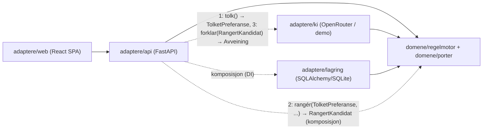
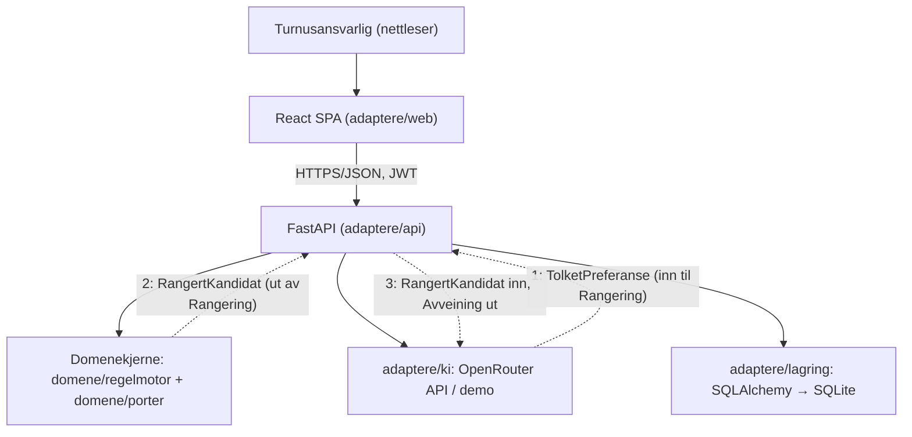
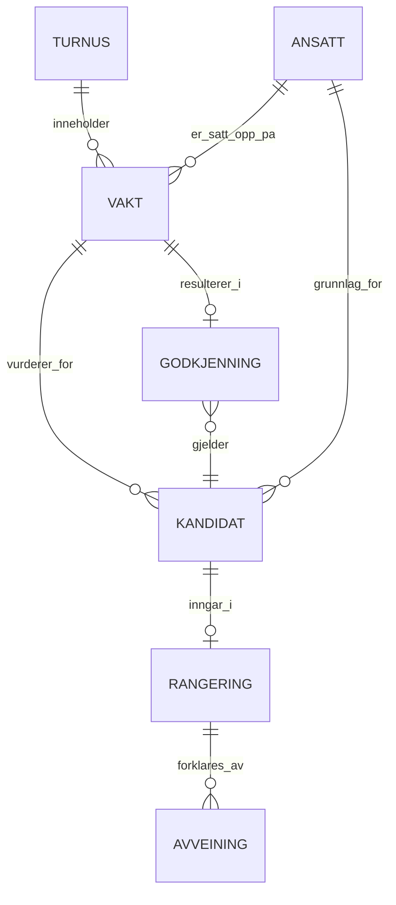

# Architecture Spine — Turnushjelperen

## Design Paradigm

Hexagonal (Ports & Adapters), lett utgave. Domenekjernen er regelmotoren — ren Python, ingen avhengighet til rammeverk eller KI. To eksplisitte typede grensesnitt (Pydantic-modellene `TolketPreferanse` og `RangertKandidat`), begge eid av `domene/porter`, er de eneste kontaktflatene mellom domenekjernen og KI-adapteren; alt annet er adaptere som avhenger av kjernen, aldri omvendt.

KI-adapteren har to atskilte, ensrettede roller — den kaller aldri inn i domenekjernen i noen av dem:
1. **Tolker** (før Rangering): `adaptere/ki` tar imot rå Ansattpreferanse-tekst og returnerer en `TolketPreferanse` — `adaptere/api` sender denne videre inn i `domene/regelmotor` som ordinær input, på linje med Kompetansenivå og Vakt-data (FR-10).
2. **Forklarer** (etter Rangering): `adaptere/ki` får beregnede fakta for en ferdig `RangertKandidat` og høyst én forhåndsberegnet, gyldig referansekandidat (P-07). KI returnerer strukturerte begrunnelser; koden validerer fakta og setter inn navn/tall før Avveining vises (P-06, FR-11).

Domenekjernen kaller aldri `adaptere/ki` selv i noen av retningene — `adaptere/api` orkestrerer begge kallene og sender resultatet inn/ut av `domene/regelmotor` som vanlige funksjonsargumenter/-returverdier.

| Lag | Modul | Rolle |
| --- | --- | --- |
| Domenekjerne | `domene/regelmotor` | Harde regler (kompetanse-minstekrav, kolliderende vakt, 11-timersregelen, 35-timersregelen), kostnadsberegning, Rangering (tar `TolketPreferanse` som input, produserer `RangertKandidat`). Ren Python, null avhengighet til KI eller rammeverk. |
| Domenekjerne | `domene/porter` | Typede grensesnitt (Pydantic-modeller: `TolketPreferanse` inn til Rangering, `RangertKandidat` ut av Rangering) — eneste kontaktflate mot driven adapters. |
| Driven adapter | `adaptere/ki` | Språkmodell-integrasjon via OpenRouter (standardmodell `openai/gpt-6-luna`, satt i miljøvariabel). To implementasjoner bak samme port: `OpenRouterKiAdapter` (live) og `DemoKiAdapter` (forhåndsgenererte svar + mal), se AD-6. Takt og nye forsøk mot leverandøren: se AD-7. To ensrettede funksjoner: tolker Ansattpreferanse-tekst → `TolketPreferanse`, og genererer Avveining fra `RangertKandidat`. Ser og produserer kun det portene definerer. |
| Driven adapter | `adaptere/lagring` | SQLAlchemy/SQLite. Persisterer Turnus, Vakt, Ansatt, Godkjenning og innloggingssesjon. |
| Driving adapter | `adaptere/api` | FastAPI-endepunkter. Komponerer/kobler sammen domenekjerne og driven adapters (KI, lagring). |
| Driving adapter | `adaptere/web` | React-SPA. Snakker kun med `adaptere/api` over HTTP. |

## Invariants & Rules

### AD-1 — Domenekjerne og KI-adapter er strukturelt atskilt

- **Binds:** hele kandidat-rangerings- og forklaringsflyten (§4.2–§4.5, FR-2 til FR-11)
- **Prevents:** at KI-adapteren beregner eller overstyrer Harde regler, kostnad eller Rangering, eller får se en Kandidat som er utelukket av en Hard regel — dette er PRD SM-2 sin testbare invariant. Forhindrer også at Rangeringen slutter å være reproduserbar (SM-5) fordi en språkmodell tolker den samme preferanseteksten ulikt fra kall til kall.
- **Rule:** `domene/regelmotor` og `domene/porter` har ingen importer av `adaptere/ki`, verken direkte eller transitivt, i noen retning — håndheves statisk med et import-linter-kontrakt. `adaptere/ki` kalles aldri av domenekjernen; `adaptere/api` orkestrerer begge retningene (se Design Paradigm):
  1. **Inn i Rangering:** `adaptere/ki` tolker rå Ansattpreferanse-tekst til en `TolketPreferanse`. Vellykket tolkning caches/persisteres per Ansatt/preferansetekst; ved venting eller feil mottar `domene/regelmotor` midlertidig 50 poeng med egen status, aldri en oppdiktet nøytral tolkning (P-05). Rangeringen gjør aldri et live KI-kall.
  2. **Ut av Rangering:** `adaptere/ki` mottar bare forhåndsberegnede fakta for gyldige kandidater. Nr. 1 får nr. 2 som referanse, øvrige får nr. 1; én kandidat får ingen referanse. Sammenligningsfakta er beregnet i domenet og faktakontrolleres før visning (P-06/P-07).
  En statisk importsjekk alene stopper ikke kjøretidslekkasje; en test i `tester/` skal sikre at ingen utelukket kandidat-ID når KI-porten. Portene eies av `domene/porter`; kun `domene/regelmotor` konstruerer `RangertKandidat` og `UtelukkelsesOppsummering`, og kun `adaptere/ki` konstruerer en vellykket `TolketPreferanse`. `RangertKandidat` bærer minst kandidat-ID/navn, Kompetansenivå, Vaktkostnad og ordinær/overtidsfordeling (P-01/P-03), eksisterende Timebelastning i startuken (P-02/P-04), Ulempepoeng/-score og fordeling, rangeringsplass, preferansepoeng og tolkestatus. Referansesammenligning etter P-07 leveres separat som beregnede fakta. Endelig skjema fastsettes i story 4.4/5.3 og testes.

### AD-2 — Avhengighetsretning gjelder alle adaptere

- **Binds:** all (`adaptere/api`, `adaptere/web`, `adaptere/ki`, `adaptere/lagring`)
- **Prevents:** at en adapter blir en skjult avhengighet inne i domenekjernen, slik at domenekjernen slutter å være kjørbar og testbar helt uten rammeverk, database eller nettverk.
- **Rule:** Adaptere avhenger av `domene/*`, aldri omvendt. Komposisjon (hvilken konkret adapter som kobles inn hvor, f.eks. hvilken KI-adapter eller lagringsadapter) skjer i `adaptere/api` sitt oppstartslag, ikke i domenekjernen. Samme mekaniske håndhevelse som i AD-1 (import-linter-kontrakt) gjelder for *alle* fire adaptere, ikke bare `adaptere/ki` — `domene/regelmotor` og `domene/porter` skal ha null importer fra noen `adaptere/*`-pakke.



### AD-3 — Sesjon/autentisering representeres som ett JWT

- **Binds:** FR-13 og all funksjonalitet bak innlogging (§4.1–§4.6), grensesnittet mellom `adaptere/api` og `adaptere/web`
- **Prevents:** at frontend og backend bygger ulike, uforenlige antakelser om hva «innlogget» betyr (f.eks. cookie ett sted og header et annet, eller ulikt token-innhold).
- **Rule:** `adaptere/api` utsteder ett JWT ved vellykket innlogging. `adaptere/web` lagrer det i en `httpOnly`-cookie (ikke `localStorage` — reduserer XSS-eksponering) og sender det automatisk på alle etterfølgende kall. Passordhashing eies alene av `adaptere/lagring` — `adaptere/api` sender aldri passord videre i klartekst utover selve innloggingskallet, og lagrer aldri et hash-resultat selv. Ingen stille token-fornyelse i v1: JWT-et utløper, og Turnusansvarlig må logge inn på nytt (enklest for et prosjekt av denne størrelsen). Utløpstiden er 480 minutter (én vakt) og kan overstyres med `TURNUSHJELPEREN_JWT_MINUTTER`. Signeringsnøkkelen lages tilfeldig ved hver oppstart og holdes bare i minnet, så alle logges ut ved omstart (OP-10, 2026-11-06).

### AD-4 — Én feilresponsform i API-et

- **Binds:** alle responser fra `adaptere/api` mot `adaptere/web`
- **Prevents:** at frontend må spesialhåndtere ulike feilformer per endepunkt, og at «ingen gyldige kandidater» (FR-6) forveksles med en teknisk feil eller lastetilstand — et eksplisitt UX-krav (EXPERIENCE.md § State Patterns).
- **Rule:** Alle faktiske feilresponser fra `adaptere/api` følger samme strukturerte envelope: `{ "kode": string, "melding": string }` (maskinlesbar feilkode + menneskelesbar melding for utviklere/logger — **ikke** ferdig brukertekst). `melding` vises aldri verbatim i `adaptere/web`; frontend slår opp `kode` mot sin egen tekstliste og viser en tone-riktig norsk melding derfra (jf. EXPERIENCE.md § Voice and Tone — «systemet beskriver tilstand, formaner aldri»), slik at rå backend-tekst aldri lekker til brukergrensesnittet. «Ingen gyldige kandidater» (FR-6) og «Avveining feilet/tom» (FR-11, inkludert når `adaptere/ki` rammes av leverandørens fartsgrense eller tom kreditt — OpenRouter svarer 429 og 402) er ikke HTTP-feil — de er gyldige 200-svar med en eksplisitt `status`-diskriminator (f.eks. `"ok" | "ingen_gyldige_kandidater" | "avveining_feilet"`) i responsen, nettopp for å holdes atskilt fra faktiske feiltilstander og fra hverandre; samme regel gjelder disse — `adaptere/web` styrer teksten ut fra `status`, ikke et fritekstfelt fra API-et. Eksakte feilkode-verdier og fullt responsskjema per endepunkt er ikke fastsatt — se Deferred.

**P-08/P-09-presisering:** Ukjent nødvendig turnusdekning, ugyldige tider eller manglende vakt-/kostnadsgrunnlag er en datafeil, ikke `ingen_gyldige_kandidater` eller dokumentert fri. Kandidatvurdering og Godkjenning stoppes. API-/UI-kontrakten skal skille disse tilstandene; forsinkede svar for tidligere Vakt/Kandidat forkastes, og endret grunnlag krever ny beregning og bekreftelse. Eksakte feilkoder fastsettes i berørte stories. Datafeil i kandidatvurderingen er et 200-svar med `status: "datafeil"`, `kode: "mangler_turnusgrunnlag"` og `datagrense` (ISO 8601 med offset), uten kandidatliste, fastsatt i story 2.1 (Johannes, 2026-11-11), og valget binder story 2.6.

### AD-5 — Lagringsadapteren eier databaseskjemaet

- **Binds:** Godkjenning (FR-12), Innlogging (FR-13), `adaptere/lagring`
- **Prevents:** at domenekjernen eller API-adapteren utvikler sin egen, avvikende oppfatning av databasetabellene slik at skjemaet drifter.
- **Rule:** `adaptere/lagring` eier SQLAlchemy-modellene og databaseskjemaet alene. `domene/regelmotor` kjenner kun sine egne rene Python/Pydantic-typer (Vakt, Kandidat, osv.) og aldri SQLAlchemy-modeller. Konvertering mellom lagringsmodell og domenetype skjer i `adaptere/lagring`. Enhver endring av Vakt-/Turnus-tilstand (at en vakt regnes som bemannet) skjer utelukkende gjennom `adaptere/lagring` sin ene skrivefunksjon for Godkjenning, som krever et fullstendig Godkjenning-objekt som argument — det finnes ingen annen kodevei som kan skrive denne tilstanden, verken fra `adaptere/api` direkte eller fra domenekjernen. Migreringsverktøy er ikke valgt — se Deferred.

### AD-6 — KI-modus velges ved komposisjon, aldri i domenet

- **Binds:** `adaptere/ki`, oppstartslaget i `adaptere/api`, testdata og README (PRD §4.5, SM-9)
- **Prevents:** at appen ikke kan kjøres eller vurderes uten gruppens API-nøkkel; at forhåndsgenerert tekst eller maltekst utgis for live KI; og at en demovei omgår AD-1.
- **Rule:** `KI_MODUS` er `openrouter` eller `demo`. Mangler `OPENROUTER_API_KEY`, starter appen i `demo` og logger det ved oppstart — den krasjer aldri. Valget skjer kun i oppstartslaget til `adaptere/api` (AD-2). Begge implementasjonene (`OpenRouterKiAdapter`, `DemoKiAdapter`) tar imot og returnerer nøyaktig de samme porttypene, og kjøretidsinvariant-testen fra AD-1 kjøres mot begge.
  1. **Demo, tolkning:** leser forhåndsgenerert `TolketPreferanse` fra testdataene. Ukjent registrert tekst får manglende/feilet tolkestatus og midlertidig 50 poeng, ikke «Ingen registrert» (P-05).
  2. **Demo, forklaring:** slår opp forhåndsgenerert Avveining på nøkkelen (vakt, kandidat, hash av `RangertKandidat`). Finnes den ikke, eller har de underliggende dataene endret seg (annen hash), lages en maltekst utelukkende fra feltene i `RangertKandidat`. Hashen hindrer at en utdatert forklaring vises etter at f.eks. en Godkjenning har endret arbeidsbelastningen.
  Forhåndsgenererte svar lages med `OpenRouterKiAdapter` og samme prompt som live-modus; modell, dato og kommando logges i `docs/ki-logg/`. Hver gyldige Avveining i API-svaret bærer `ki_kilde: "live" | "forhandsgenerert" | "mal"`, slik at `adaptere/web` kan merke kilden (EXPERIENCE.md § Component Patterns). I `openrouter`-modus faller adapteren **ikke** stille tilbake til demo ved feil — feil gir `avveining_feilet` (AD-4) med egen Reservetekst-etikett, ikke `ki_kilde: "live"`, slik at en tom kreditt eller fartsgrense er synlig.

### AD-7 — KI-kall holdes under leverandørens fartsgrense

- **Binds:** `adaptere/ki` (`OpenRouterKiAdapter`)
- **Prevents:** at OpenRouters fartsgrense gir reservetekst ved vanlig bruk. Med `openai/gpt-6-luna` hadde gruppens konto en fast grense på 20 kall per kalenderminutt (`X-RateLimit-Limit: 20`, målt 2026-10-16). Uten tiltak feilet 40 av 60 kall i en belastningstopp.
- **Rule:** Én felles begrenser i adapteren slipper gjennom høyst 18 kall per 60 sekunder og høyst 5 samtidige. Ved 429 venter adapteren til `X-RateLimit-Reset`. For live Avveining venter adapteren 2, 4 og 8 sekunder ved 5xx og nettverksfeil; ventingen, også ved 429, må holde seg innen Avveiningens tidsbudsjett. Bare en faktakontrollert forklaring vises; innen 90 sekunder fra første live-kall vises ellers tydelig merket reservetekst via `avveining_feilet` (AD-4, AV-15). 402, andre 4xx og ubrukelige svar prøves ikke på nytt. Lukkede Avveininger hentes først når raden åpnes (UX-DR12), og preferanser tolkes i bakgrunnen når testdataene lastes inn (story 5.1). Begrenseren og 429-ventingen gjelder begge KI-funksjonene; ventetrinn ved 5xx/nettverksfeil, antall nye forsøk, tidsbudsjett, startpunkt og sluttstatus for preferansetolkning avklares samlet før story 5.1, uten å bruke `avveining_feilet` som tolkestatus. Begrenserens tall og Avveiningens ventetrinn er konstanter i adapteren og justeres hvis kontoens grense endres. Prototype, tester og målinger: `scripts/modelltest_robusthet.py` og `docs/ki-logg/2026-10-16-robusthet-luna.md` (218 av 218 kall levert, uten 429).

## Consistency Conventions

| Concern | Convention |
| --- | --- |
| Naming (entities, files, interfaces, events) | Domenebegreper bruker PRD §3 sine termer presist, også i kode der det er treffende (Kandidat, Gyldig kandidat, Hard regel, Kompetansenivå, Rangering, Avveining, Godkjenning), jf. AGENTS.md om norsk dokumentasjon/engelsk der det er mer presist. Modulnavn følger Design Paradigm-tabellen (`domene/regelmotor`, `domene/porter`, `adaptere/api`, `adaptere/ki`, `adaptere/lagring`, `adaptere/web`) — engelske fellesbegreper som «adapter»/«port» beholdes på engelsk. |
| Data & formats (ids, dates, error shapes, envelopes) | Feilresponsform og statusdiskriminator: se AD-4. Datoer/klokkeslett i API-kontrakten: ISO 8601. Tidssone: alle Vakt-tidspunkt lagres og beregnes i `Europe/Oslo` (DST-bevisst, ikke fast UTC-offset) — én autoritativ tidssone på tvers av domenekjerne og lagring, avgjørende for at 11-timers-/35-timersregelen (FR-4, FR-5) gir samme resultat for samme input hver gang (SM-1, SM-5), særlig rundt sommertid-overganger. Identifikatorer tildeles og eies av `adaptere/lagring` (SQLAlchemy primærnøkler); konkret ID-format (int vs. UUID) er en implementasjonsdetalj, ikke fastsatt her. |
| State & cross-cutting (mutation, errors, logging, config, auth) | Auth/sesjon: se AD-3. Ingen mutasjon av Turnus-/Vakt-tilstand uten eksplisitt Godkjenning (FR-12) — håndheves i `adaptere/api`, aldri i frontend alene. Config: API-nøkler og hemmeligheter leses kun fra miljøvariabler, aldri hardkodet — KI-laget bruker `OPENROUTER_API_KEY`, `OPENROUTER_MODEL` (standard `openai/gpt-6-luna`) og `KI_MODUS` (`openrouter` \| `demo`, se AD-6). Sesjonen bruker `TURNUSHJELPEREN_JWT_MINUTTER` (utløpstid, standard 480) og testdatakommandoen `TURNUSHJELPEREN_PASSORD`. JWT-signeringsnøkkelen er ingen miljøvariabel: den lages tilfeldig ved hver oppstart og holdes bare i minnet (OP-10, 2026-11-06); nye variabler dokumenteres uten verdier i `.env.example`, iht. AGENTS.md. Runtime-driftslogging er ikke besluttet — se Deferred. KI-genereringslogg (separat fra runtime-logging, en dokumentasjonskonvensjon, ikke arkitektur): AI-generert kode logges i `docs/ki-logg/<dato>-<tema>.md`, iht. AGENTS.md. |
| Testing (kvalitetssikringsbevis) | pytest på backend. Ett testmodul per hard regel i regelmotoren (kompetanse-minstekrav, kolliderende vakt, 11-timersregelen, 35-timersregelen) — konvensjon, ikke bare praksis, og den konkrete mekanismen som håndhever AD-1/AD-2 sine grenser (f.eks. en test som feiler dersom `domene/regelmotor` importerer `adaptere/ki`). |

## Stack

| Name | Version |
| --- | --- |
| FastAPI (Python) | 0.141.1 (verifisert 2026-09-29) |
| React | 19.3.0 |
| Vite | 8.3.1 |
| TypeScript | 7.0.2 (verifisert 2026-09-29; native Go-kompilator, avløste 5.x/6.x-linjen) |
| SQLite (via SQLAlchemy) | Ikke versjonsfestet — se Deferred |
| OpenRouter API (OpenAI-kompatibelt) | Modell `openai/gpt-6-luna`, låst til leverandøren `openai` (verifisert 2026-10-15: $0.10 / $0.50 per million tokens inn/ut, støtter `structured_outputs`). Valgt 2026-10-16 etter modelltest, se `docs/ki-logg/2026-10-16-beslutningstest-haiku-luna.md`. Strukturert output via JSON-skjema; resonnering av. Modellen settes i `OPENROUTER_MODEL` og kan byttes uten kodeendring. Klientbibliotek ikke valgt — se Deferred. Erstatter `anthropic/claude-haiku-5.5` (valgt 2026-10-14) og Google Gemini (valgt 2026-09-29), se `.memlog.md`. |

## Structural Seed

### System-/containeroversikt



**Kjøremiljø:** kun lokal kjøring for nå (ingen hosting besluttet). Se Deferred.

### Kjernedomene (ERD — navn og relasjoner, ingen detaljerte felter)



Gyldig kandidat, Hard regel og Kompetansenivå er ikke egne entiteter her — Gyldig kandidat er en beregnet tilstand på Kandidat (filtrert av Hard regel, se AD-1), og Kompetansenivå er et attributt på Ansatt/Kandidat som bare inngår i filtreringen (Hard regel) og ikke gir poeng i Rangeringen, jf. PRD §3 og §4.4. Tolket preferanse (se AD-1) er heller ikke egen entitet i dette diagrammet, men lagres av `adaptere/lagring` knyttet til Ansatt — den er inputet Rangering leser, ikke et resultat av den.

Avveining lagres ikke historisk ved Godkjenning i kjerneversjonen (P-12). Kun selve Godkjenningen (hvem, hvilken Vakt, når) lagres varig. Ved endret grunnlag før Godkjenning må nye beregninger vises og brukeren bekrefte på nytt (P-09). Eventuell senere historisk lagring av nøyaktig vist forklaring og beregningsgrunnlag krever egen beslutning/story og er ikke v1-krav.

### Minimal kildetre

```text
turnushjelperen/
  backend/
    domene/
      regelmotor/      # harde regler, kostnadsberegning, rangering — domenekjerne
      porter/          # typede grensesnitt (Pydantic), f.eks. RangertKandidat
    adaptere/
      api/             # FastAPI-endepunkter (driving adapter)
      ki/               # OpenRouter- og demo-adapter (driven adapter, ser kun porten, AD-6)
      lagring/          # SQLAlchemy/SQLite-repository (driven adapter)
    tester/
      regelmotor/       # ett testmodul per hard regel
  frontend/
    src/                # React SPA (driving adapter, kun HTTP mot adaptere/api)
  docs/
    ki-logg/            # KI-genereringslogg, iht. AGENTS.md
  .env.example           # navngitte, udokumenterte miljøvariabler, iht. AGENTS.md
```

## Capability → Architecture Map

| Capability / Area | Lives in | Governed by |
| --- | --- | --- |
| §4.1 Vaktvalg (FR-1) | `adaptere/api`, `adaptere/web` | Design Paradigm, IA i EXPERIENCE.md |
| §4.2 Regelmotor / harde regler (FR-2–FR-6) | `domene/regelmotor` | AD-1, AD-2, Testing-raden i Consistency Conventions |
| §4.3 Kostnad og arbeidsbelastning (FR-7–FR-8, FR-14) | `domene/regelmotor` | AD-1, AD-2 (reproduserbart, uavhengig av KI) |
| §4.4 Rangering (FR-9) | `domene/regelmotor` | AD-1, AD-2 |
| §4.5 KI-tolkning av preferanser og Avveining (FR-10–FR-11) | `adaptere/ki` (begge retninger), `domene/regelmotor` (konsumerer `TolketPreferanse`) | AD-1 (den harde systemgrensen og de to portene), AD-6 (KI-modus), AD-7 (takt og nye forsøk), config-raden i Consistency Conventions (OpenRouter-nøkkel) |
| §4.6 Godkjenning av erstatter (FR-12) | `adaptere/api`, `adaptere/lagring` | AD-4 (feilform), AD-5 (skjemaeierskap), State-raden (ingen mutasjon uten Godkjenning) |
| §4.7 Innlogging (FR-13) | `adaptere/api`, `adaptere/lagring` | AD-3 (JWT/sesjon) |

## Deferred

- ~~**Vekting mellom Myke faktorer i Rangeringen**~~ (PRD §8, spørsmål 2) — **løst 2026-10-06, oppdatert 2026-10-15 og 2026-10-30, godkjent av gruppa 2026-11-02.** Kostnad 40 %, arbeidsbelastning 35 % (Timebelastning 20 %, Ulempebelastning 15 %), Ansattpreferanse 25 %. Kompetanse vurderes bare som Hard regel og gir ingen rangeringspoeng. Vektene og taket for Ulempescore (300) er navngitte parametere i `domene/regelmotor`, ikke miljøvariabler. Se PRD §4.3, §4.4 og ÅB-1/ÅB-3 i epics.md.
- ~~**Konkret kostnadsgrunnlag**~~ — avklart i P-01–P-03: merkostnad ved tildeling, faktisk tidsfordeling per berørt uke, totalbeløp og timer × satser. Implementasjon og grensetester gjenstår.
- **Ordlyd for «ingen gyldige kandidater», «innlogging feilet» og «beregner rangering»** (EXPERIENCE.md § State Patterns, merket `[ASSUMPTION]`) — atferden er spesifisert (skal skille seg tydelig fra feil/lastetilstand), men eksakt tekst er åpen.
- **Responsive breakpoints (P-13/OP-02)** — desktop og tilgjengelighetskrav gjelder nå; mobil/nettbrett avklares etter fungerende kandidatvisning og før story 4.6. 1180px er en mockupramme; faktisk innhold bruker `max-width` (AV-14). Oppgavebasert forståelsestest gjenstår.
- **Hosting/driftsmiljø** — kun lokal kjøring er besluttet. Render sin gratis-tier er nevnt som en mulig senere utvidelse (sovner etter 15 min inaktivitet, ca. 1 min kaldstart), men ikke valgt.
- **Klientbibliotek mot OpenRouter** — valget mellom OpenAI-SDK-et og en ren HTTP-klient i `adaptere/ki` er ikke besluttet. Takt og nye forsøk er besluttet i AD-7.
- **Preferansetolkning ved feil (P-05/AV-15)** — avgrensede automatiske forsøk og egen vente-/feilstatus er vedtatt. Antall forsøk, tidsbudsjett og sluttstatus ved 429, 5xx og nettverksfeil fastsettes før story 5.1; avveiningens 90-sekundersgrense er ikke automatisk en tolkingsfrist.
- ~~**JWT utløpstid** (AD-3)~~ — besluttet 2026-11-06 i spesifikasjonen for story 1.3 (OP-10): 480 minutter (én vakt) som standard, overstyrbar med `TURNUSHJELPEREN_JWT_MINUTTER`. Representasjonsform (httpOnly-cookie, ingen stille fornyelse i v1) var besluttet fra før.
- **SQLite-skjema/migreringsverktøy** (AD-5) — f.eks. Alembic vs. håndrullet migrering er ikke valgt. Samme gjelder eksakt SQLAlchemy-versjon (se Stack) og ID-format (int vs. UUID, se Consistency Conventions).
- **Feilenvelope-detaljer** (AD-4) — envelope-form og statusdiskriminator er besluttet; eksakte feilkode-verdier og fullt responsskjema per endepunkt er ikke.
- **Historisk Avveining (P-12B)** — utsatt; ikke krav i v1. En senere beslutning må omfatte både nøyaktig vist tekst og beregningsgrunnlag.
- **Transport for progressiv lasting av Avveining** (EXPERIENCE.md § State Patterns, «Beregner rangering», merket `[ASSUMPTION]`) — at rader vises før KI-forklaringen er ferdig er foreslått, men om dette løses med streaming, polling, eller flere separate kall er ikke besluttet.
- **Runtime-/driftslogging** — ikke besluttet (skilt fra den allerede bindende KI-genereringsloggen i `docs/ki-logg/`, se Consistency Conventions).
